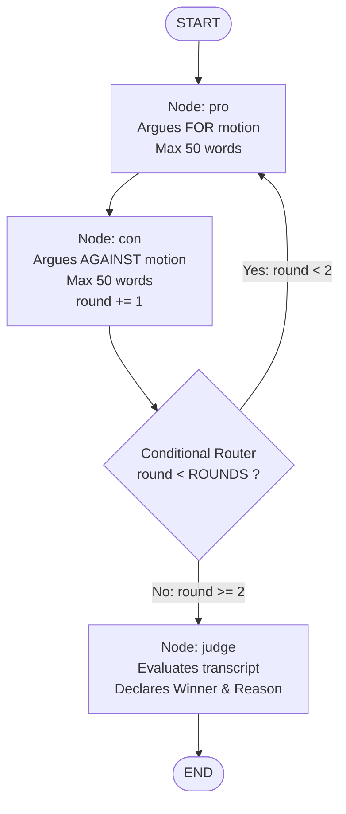

# 🎙️ Multi-Agent Debate CLI (LangGraph + Ollama)

A multi-agent debate CLI application built in Python using **LangChain**, **LangGraph**, and local **Ollama** (`llama3.2`).

Two debaters (**PRO** and **CON**) battle it out across configured rounds, adhering to strict debate rules and word constraints, before an impartial **JUDGE** evaluates the debate transcript and crowns the winner.

---

## 🏗️ Architecture & Graph Flow

The debate workflow is modeled as a cyclic state graph in LangGraph:



---

## ⚡ Key Features

- **Local & 100% Free**: Powered by Ollama (`llama3.2`), running entirely offline without API keys or costs.
- **Strict Turn Enforcement**: 
  - **PRO** argues **FOR** the motion, replying to the opponent's prior argument if one exists.
  - **CON** argues **AGAINST** the motion, counters PRO's latest point, and increments the round counter.
  - Speeches strictly capped at **50 words max** using `trim_words`.
- **Impartial Adjudication**: The JUDGE reviews the full transcript, assesses reasoning and responsiveness, and outputs an exact verdict in the format:
  ```text
  Winner: PRO (or Winner: CON)
  Reason: <one short sentence>
  ```
- **Real-time CLI Streaming**: Live streams each speech (`🟢 PRO` / `🔴 CON`) as nodes complete, followed by the judge's verdict and winner badge.

---

## 📦 Project Structure

```text
debate agent/
├── agent.py          # Complete LangGraph debate implementation & CLI loop
├── app.py            # Interactive Streamlit Web UI
├── prompt.md         # Reference prompts & build specification
├── requirements.txt  # Python package dependencies
└── README.md         # Project documentation and guide
```

---

## 🚀 Setup & Installation

### 1. Prerequisites
Ensure you have [Ollama](https://ollama.com/) installed and running. Pull the `llama3.2` model:

```bash
ollama pull llama3.2
```

### 2. Install Dependencies
Install the required packages using pip:

```bash
pip install -r requirements.txt
```

*(Dependencies: `langchain`, `langchain-ollama`, `langgraph`)*

---

## 🌐 Running in the Web Browser (Streamlit Web UI)

You can run this multi-agent debate with a full visual interface directly in your browser:

```bash
streamlit run app.py
```

This will automatically launch the web interface at **`http://localhost:8501`** featuring:
- **Real-Time Live Streaming**: Watch PRO (green) and CON (red) arguments appear dynamically round by round.
- **Judge Verdict Banner**: Impartial adjudication, reasons, and winner badge.
- **Configurable Sidebar**: Adjust rounds (1–4), model name, and temperature, or pick from popular debate topics.

---

## 💻 CLI Usage

### Interactive CLI Loop
Run `agent.py` without arguments to launch the interactive prompt:

```bash
python agent.py
```

Then enter your motion when prompted:
```text
Motion: Artificial Intelligence will create more jobs than it destroys
```

To exit the loop, type `exit`, `quit`, or press `Ctrl+C`.

### Direct Argument Invocation
You can also run a debate directly by passing the motion as command-line arguments:

```bash
python agent.py "Remote work is better than office work"
```

---

## ⚙️ Configuration

In `agent.py`, you can customize:
- `ROUNDS`: Total debate rounds (default: `2`).
- `MODEL_NAME`: Ollama model tag (default: `llama3.2` or overridden via `OLLAMA_MODEL` environment variable).
- `TEMPERATURE`: LLM sampling temperature (default: `0.7`).

---

## 📋 State Schema

```python
class DebateState(TypedDict):
    motion: str              # Debate topic
    speeches: List[str]      # List of 'PRO: ...' / 'CON: ...'
    round: int               # Current round index
    verdict: Optional[str]   # Full text verdict from judge
    winner: Optional[str]    # 'PRO' | 'CON' | 'TIE'
```
